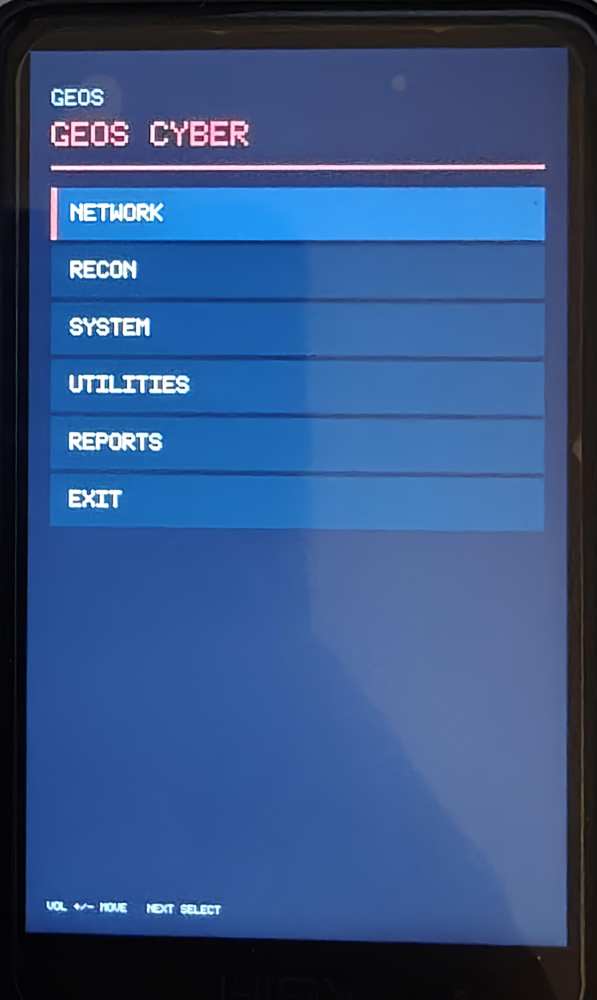
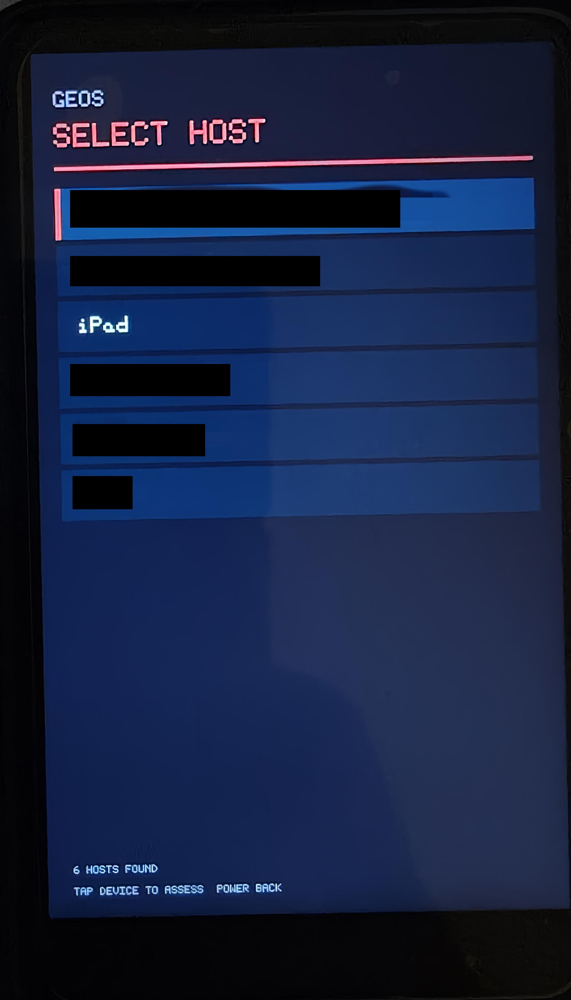
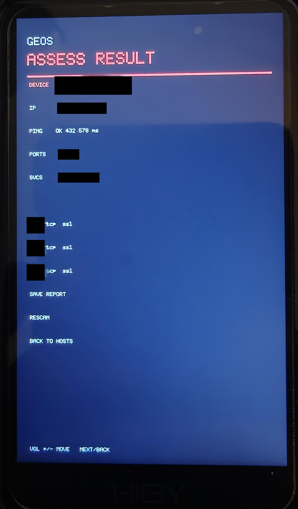
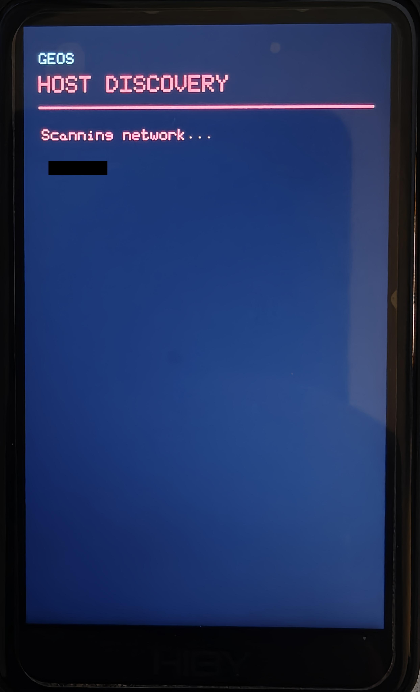
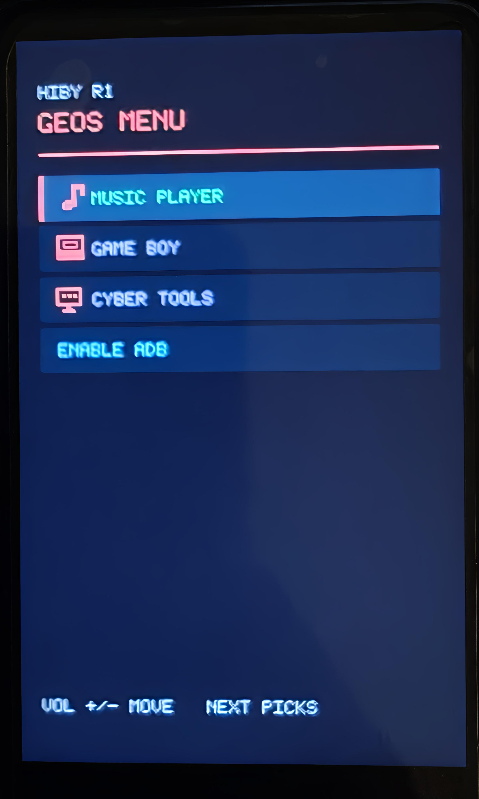
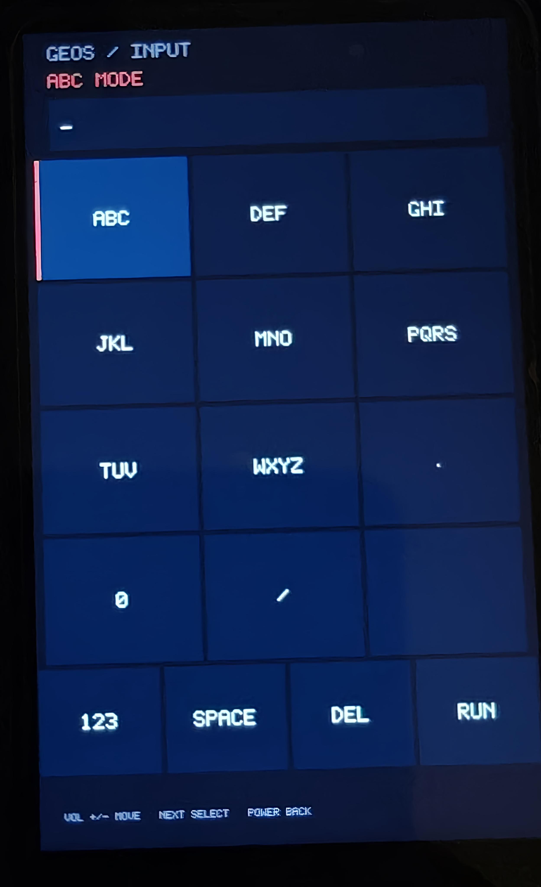

# HiBy R1 MP3 Network Diagnostic Tool

An experimental on-device network diagnostics interface for the HiBy R1 music player. The GEOS Cyber menu provides a screen-based front end for network discovery and diagnostic commands.

This repository gathers the application source, build rules, and redacted screenshots. It does not distribute a firmware image.

> Use scanning and diagnostic features only on devices and networks you own or have permission to assess.

## Screenshots

Captured on a HiBy R1. Host identifiers and network addresses are obscured in the screenshots where they appear.








## Layout

- `app/src/` — application and packet capture source.
- `app/include/` — application headers.
- `app/helpers/` — device helper program source.
- `app/Makefile` — MIPS cross-build rules.
- `third_party/Hiby-R1-Mod` — pinned upstream dependency for the shared display, input, and font layer.
- `docs/` — build notes and screenshots.

Initialize the upstream dependency after cloning:

```sh
git submodule update --init --recursive
```

See [docs/BUILDING.md](docs/BUILDING.md) for build inputs and limitations.

## Excluded

Firmware packages and extracted firmware files, the Wi-Fi kernel module, compiled device binaries, packet captures, Nmap and Nexmon source trees, ROM images and save files, and personal music are excluded.

## Status

This is an experimental project. The screenshots document observed device behavior. The repository build recipe has not been tested as part of this setup.
